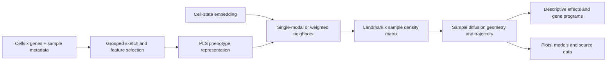
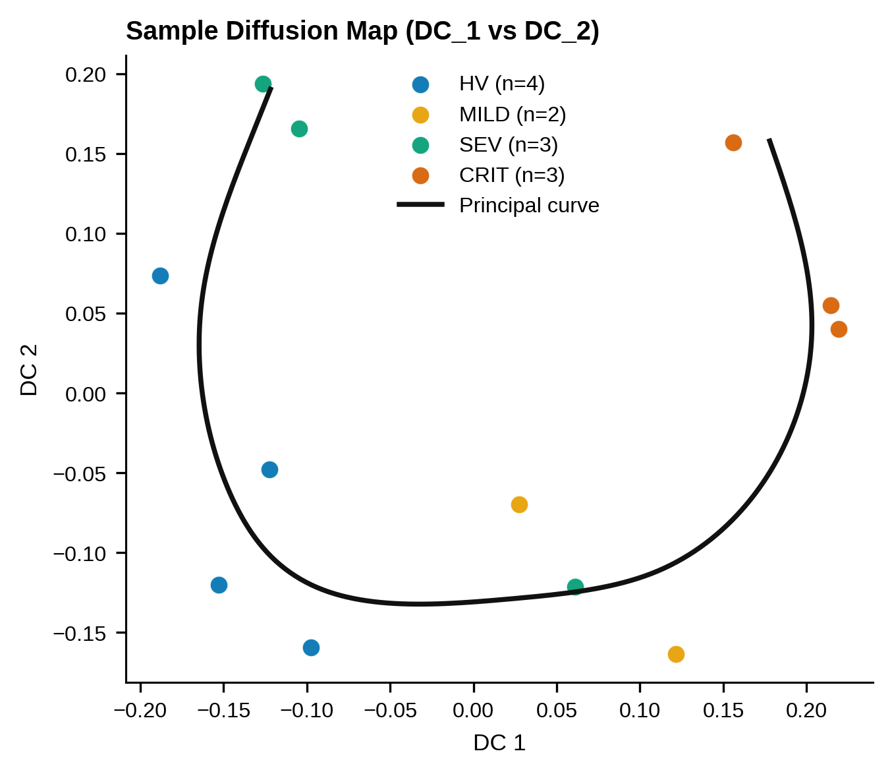
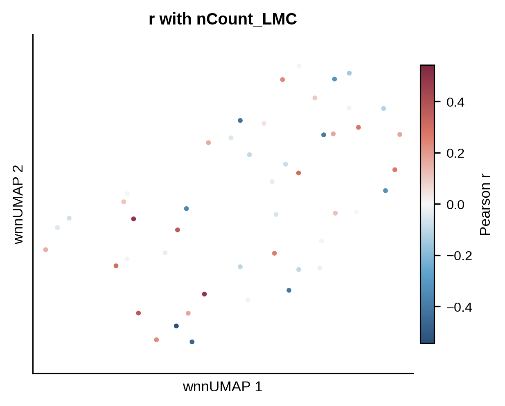
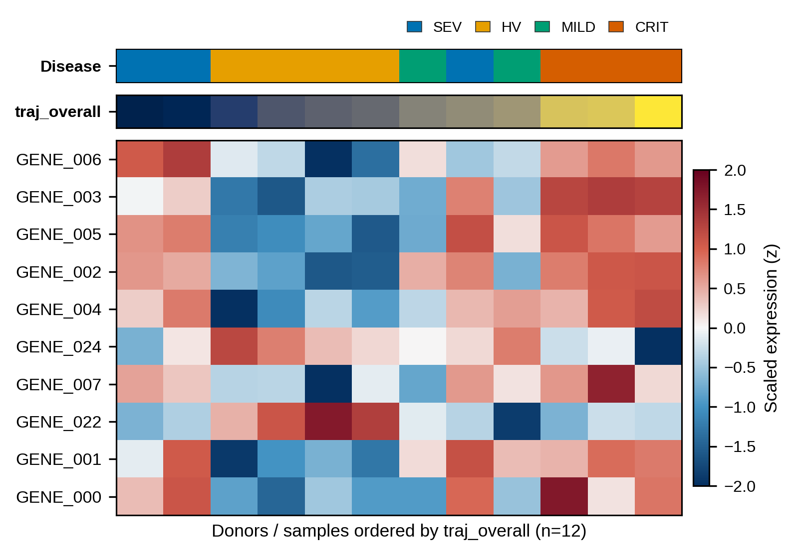
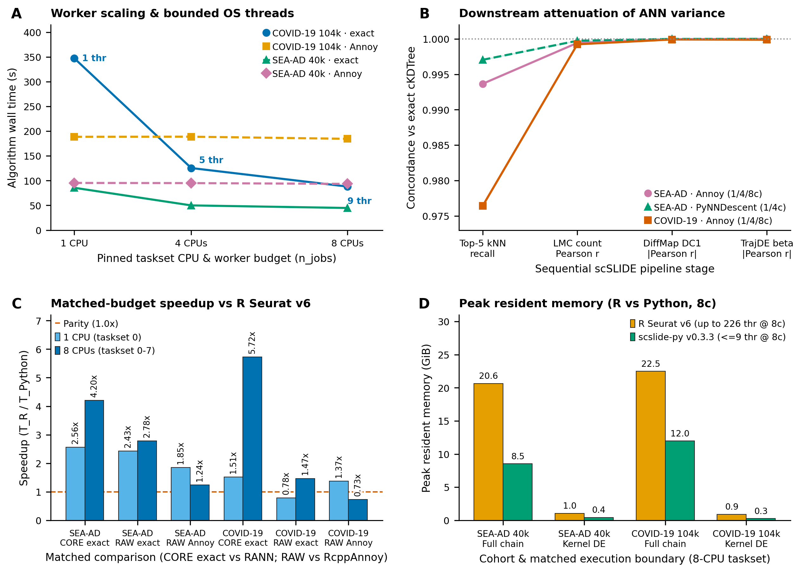

# scSLIDE-py

### A complete native-Python alternative for the core scSLIDE sample-level workflow

**Discover how samples differ through the distributions of their cells—not only average expression or cell-type proportions.** scSLIDE-py brings the scSLIDE workflow to Python with AnnData interoperability, native PLS and weighted-neighbor algorithms, sample trajectories, descriptive gene associations, portable examples and source-linked figures. **No R runtime or `rpy2` is needed for the core Python analysis.**

[中文](README.zh-CN.md) · [Install](#installation) · [Quickstart](#quickstart) · [R comparison](#validated-against-r) · [Gallery](docs/gallery.md) · [Documentation](docs/README.md)

**Version 0.3.3 · Linux x86_64 · Python 3.10–3.12 · MIT**

This is an independently maintained community implementation of the [original scSLIDE method](https://github.com/satijalab/scSLIDE), not an official Satija Lab distribution. It is a practical alternative for the **documented R workflows**, not an interpreter for unchanged R scripts or a replacement for the entire Seurat ecosystem. Public registry availability is not assumed; installation from this source tree or the exact included artifact is supported.

## Why use scSLIDE-py?

| Capability | What you get |
|---|---|
| **Full core method in Python** | Implemented counterparts for all 19 upstream exports: grouped sketching, PLS families, projection, WNN, landmark densities, diffusion geometry, correction and descriptive TrajDE |
| **AnnData-first workflows** | Explicit cell/sample/landmark units; dense and CSR/CSC data; validated H5AD/Zarr and chunked-operation paths |
| **R-backed compatibility** | Stored golden outputs from legacy scSLIDE and Seurat v6; real-case matched-input comparisons, explicit profile differences and negative controls |
| **Reusable fitted models** | Named-feature alignment, safe NPZ persistence and projection of new query cells without silently changing gene order |
| **Visible execution choices** | Exact neighbors by default, optional Annoy, explicit UMAP backend selection, recorded resource settings and actionable errors |
| **Figures and reproducibility** | Sample and landmark plots, trajectory heatmaps, PNG/PDF/SVG exports, CSV source data, a portable synthetic example and an R migration guide |

The package stands on its own: `import scslide` does not require OmicVerse. The optional [OmicVerse adapter PR #1098](https://github.com/omicverse/omicverse/pull/1098) and [tutorial PR #145](https://github.com/omicverse/omicverse-tutorials/pull/145) have real-backend and notebook validation; upstream review is pending. See [integration status](docs/omicverse_integration.md).

## From cells to samples



The two statistical units stay distinct. A cell AnnData has cells as observations; a **sample AnnData has samples as observations and landmarks as variables**. Sample-level coordinates must not be written onto a cell-level observation axis. Repeated samples from the same subject are not independent biological replicates.

## Output gallery

These are **real saved outputs of the portable synthetic user example**, not invented images or disease discoveries. Every panel has source data and vector versions in the [gallery](docs/gallery.md).

| Sample geometry | Landmark-state view |
|---|---|
|  |  |



The example uses 420 cells and 60 genes, with 14 samples and a 12-primary-subject displayed task. Use it to learn the interface; use the separate COVID/SEA-AD evidence to assess real-case compatibility.

## Installation

### Install the public verified artifact (Python 3.11)

The exact audited wheel is publicly downloadable from this repository; no GitHub
login or source checkout is needed. The URL pins the clean software commit and
wheel SHA256. This is GitHub distribution, not a PyPI release.

```bash
python3.11 -m venv .venv
source .venv/bin/activate
python -m pip install --constraint "https://raw.githubusercontent.com/LCGaoZzz/scSLIDE-py/57605d55054a3c26b0d30721f696ef67eab1809d/constraints/verified-primary-py311.txt" \
  "scslide-py[anndata] @ https://raw.githubusercontent.com/LCGaoZzz/scSLIDE-py/57605d55054a3c26b0d30721f696ef67eab1809d/artifacts/scslide_py-0.3.3-py3-none-any.whl#sha256=02043e3c1215320beca93c9ce58645f4fdebf29796dbbdc30d7ce00a580aacbd"
python -m pip check
```

[Publication and download verification](docs/PUBLICATION.md)

### Install the included artifact from a checkout

From the repository root in a clean Python 3.11 environment:

```bash
python3.11 -m venv .venv
source .venv/bin/activate
(cd artifacts && sha256sum -c SHA256SUMS)
python -m pip install --constraint constraints/verified-primary-py311.txt \
  "./artifacts/scslide_py-0.3.3-py3-none-any.whl[anndata]"
python -m pip check
```

The recommended artifact is **`scslide-py-0.3.3-02043e3c1215`**. Its full hash and source identity are in [artifacts/manifest.json](artifacts/manifest.json). Several pre-release internal candidates used version `0.3.3`; the hash identifies the validated bytes.

### Install from the current source

```bash
python -m pip install ".[anndata]"
```

This builds from the checkout, including its current packaging documentation, and is not the same ZIP as the archived artifact. Core numerical use needs only `python -m pip install .`; add `[annoy]` for Annoy, or `[ann]` for umap-learn and the experimental PyNNDescent path. `[ann]` does not install Annoy.

See [supported environments](docs/SUPPORTED_ENVIRONMENTS.md) for exact tested dependency profiles, storage lifecycles and thread controls. Unvalidated platforms or arbitrary future dependency combinations are not implied by the Python version requirement.

## Quickstart

Start with a small, license-clean cohort that requires no external patient data:

```python
import scslide as sl

adata = sl.build_synthetic_cohort_fixture(seed=20261116)
assert adata.uns["scslide_demo"]["synthetic_demo_only"]

result = sl.run_scslide_workflow(
    adata,
    sample_col="Donor",
    subject_id_sep="-",             # this synthetic fixture's naming convention
    response_col="Disease",
    celltype_col="cell_type",
    embedding_key="X_pca",
    dims_embedding=range(8),
    ncells_per_group=20,
    ncells_landmark=40,
    knn_range=40,
    ncomp_pls=4,
    nn_method="exact",
    n_jobs=1,
    de_celltype="CD14_Mono",
    de_covariates=("Age", "Sex", "log_count"),
    de_inference_mode="descriptive_r_compat",
)

print(result.sample_adata)           # obs=samples, var=landmarks
print(result.diffusion.embeddings)   # sample-indexed coordinates
print(result.de_results["CD14_Mono"].head(3)[
    ["gene_ID", "beta_Traj", "p_Traj", "adj_pval"]
])
```

For real data, provide and validate the actual sample-to-subject mapping rather than guessing from sample names. Counts, normalized layers, feature selection and the cell embedding must match your study design; the [migration guide](docs/R_TO_PY_MIGRATION.md) explains the contract.

Run the complete save/read, named-query projection and plotting example:

```bash
python examples/r_to_python_migration_quickstart.py --out-dir ./scslide-demo-output
```

Use a new output directory. The example produces H5AD/Zarr objects, NPZ model state, figures and CSV sidecars. [Full tutorial](docs/tutorial.md) · [Algorithm and API map](docs/algorithm.md)

## Full workflow coverage

| Analysis block | R functions / behavior | Native Python entry points |
|---|---|---|
| Sample preparation | `SketchDataByGroup`, `QuickCorTest`, `PrepareSampleObject` | `sketch_data_by_group`, `quick_cor_select`, `prepare_sample_object` |
| Supervised representation | `RunPLS`, `cppls_ondisk`, `kernelpls` | `fit_pls`, `run_pls`, `cppls_ondisk`, `kernelpls`, `kernelpls_ondisk` |
| Projection | `PredictPLS` and reference projection | `predict_pls`, `project_pls_embeddings`, `PLSModel` |
| Neighbors | `FindsmNN`, `FindmmNN` | `find_sm_nn`, `find_mm_nn`, `compute_modality_weights` |
| Sample density | `GenerateSampleObject`, `NormalizeChiSquared` | `generate_sample_object`, `landmark_matrix`, `normalize_chi_squared` |
| Sample geometry | `RunDiffusionMap`, principal curves | `run_diffusion_map`, `fit_principal_curve` |
| Descriptive expression | `TrajDETest` | `traj_de_test` |
| Control-referenced correction | `CorrectSampleComBat`, `cellanova_calc_BE` | `correct_sample_combat`, `cellanova_calc_be` |
| Landmarks and plotting | `BuildLandmarkObject`, `RunAndProjectUMAP`, `PlotLandmarkObject`, `SampleLevelDimPlot` | `build_landmark_object`, `run_and_project_umap`, `plot_landmark_object`, `sample_level_dim_plot` |

The [complete 19-capability map](docs/algorithm.md) documents solver branches, normalization details, reference profiles and sparse/backed limits. This is substantive workflow coverage—not merely a set of aliases around R.

## Validated against R

The verified core combines package regression tests, stored reference outputs from two R profiles, deliberate negative controls and retrospective matched-input COVID/SEA-AD comparisons. The installed candidate has **43 distinct package tests**, **47 stored-golden checks**, and **6 corruption-detecting controls** in its audit; repeated environment runs and helper tests are not counted as new numerical tests.

| Saved matched exact-R comparison | COVID | SEA-AD Microglia-PVM |
|---|---:|---:|
| Cells in the case input | 104,447 | 40,000 |
| Shared eligible genes | 8,355 | 14,733 |
| LMC counts | Exact match | Exact match |
| Signed trajectory rank correlation | +1 | −1 |
| Signed TrajDE coefficient correlation | +0.99997068 | −0.99999922 |
| Through-zero coefficient scale | +0.9972623 | −0.99769023 |

**SEA-AD's trajectory is oriented in the opposite direction**, so the coefficients reverse with it. This is strong agreement in represented structure, not raw sign equality. Define the biological direction before interpreting up/down regulation. Exact and Annoy comparisons remain separate.

These case figures were recalculated from saved matched outputs; the final narrow resource/error-handling repair did not rerun every disease analysis. Installed-package/golden/backend checks support bounded inheritance. See [R comparison](docs/comparison_with_R.md) and [evidence index](docs/evidence_index.md) for methods, scope and limitations.

## Runtime and memory

Historical paired benchmarks cover kernels, shared-preprocessing chains and count-to-result workflows under recorded 1/8-CPU conditions. **20 of 24 algorithm-time conditions favored Python; four favored R.** The historical R/Python time ratio ranged approximately **0.70–5.72**, and Python/R peak-RSS ratios were approximately **0.29–0.54**.



All conditions—including slower Python cases—are retained in the [benchmark page](docs/benchmark.md) and its CSV. These are historical measured-build results, not a promise that the final repaired ZIP is universally faster. The figure's absolute-correlation panels do not override the signed comparison above.

## When is this representation useful?

scSLIDE is useful when a cohort's signal involves **cell-state distributions**, continuous sample heterogeneity or mixtures of states that may not be captured by coarse proportions and average expression. It is not necessary for every task: proportions can be sufficient for pure composition shifts, and pseudobulk can be strong for mean shifts. The Python implementation aims to preserve the original method's scientific behavior and useful operating range, not claim superiority on every dataset.

## What is stable, and what is exploratory?

The stable scope is the documented core representation, storage, plotting and R-compatible descriptive workflow in tested environments. Response labels enter supervised learning; separation by those same labels is not independent predictive validation. Learned-trajectory p/q values are descriptive/post-selection. OOF, count splitting and permutation extensions remain explicitly exploratory, without a universal FDR/FWER claim. These boundaries are detailed in [scientific usage](docs/scientific_usage_and_migration.md) and [release scope](docs/RELEASE_SCOPE.md).

## Documentation, reproducibility and contribution

[Documentation](docs/README.md) · [R migration](docs/R_TO_PY_MIGRATION.md) · [Gallery and source data](docs/gallery.md) · [Environment matrix](docs/SUPPORTED_ENVIRONMENTS.md) · [Maintenance](docs/MAINTENANCE_AND_ROLLBACK.md)

Please cite the original method and acknowledge this independent implementation using [CITATION.cff](CITATION.cff) and [NOTICE](NOTICE). Preserve the [MIT license](LICENSE) and upstream attribution. Report reproducible issues with redacted metadata—not patient matrices or credentials.

**scSLIDE-py is the standalone algorithm project.** OmicVerse is an optional integration route, not a replacement for this package or an implied upstream endorsement.
