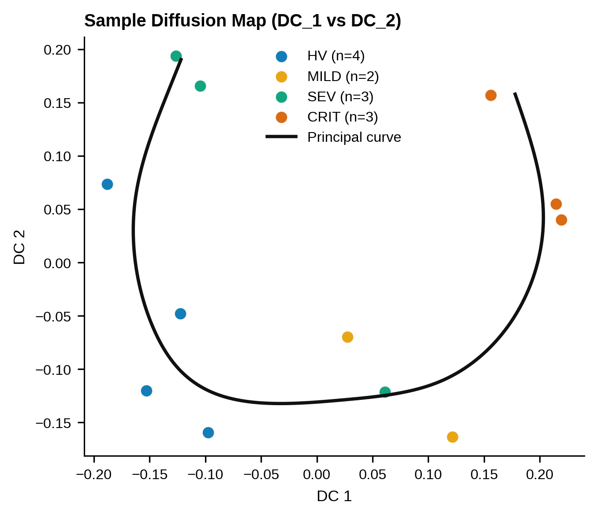
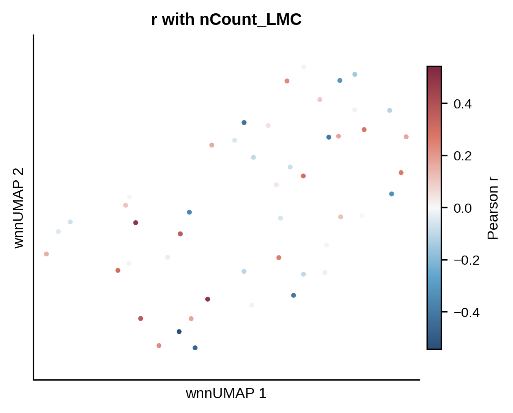
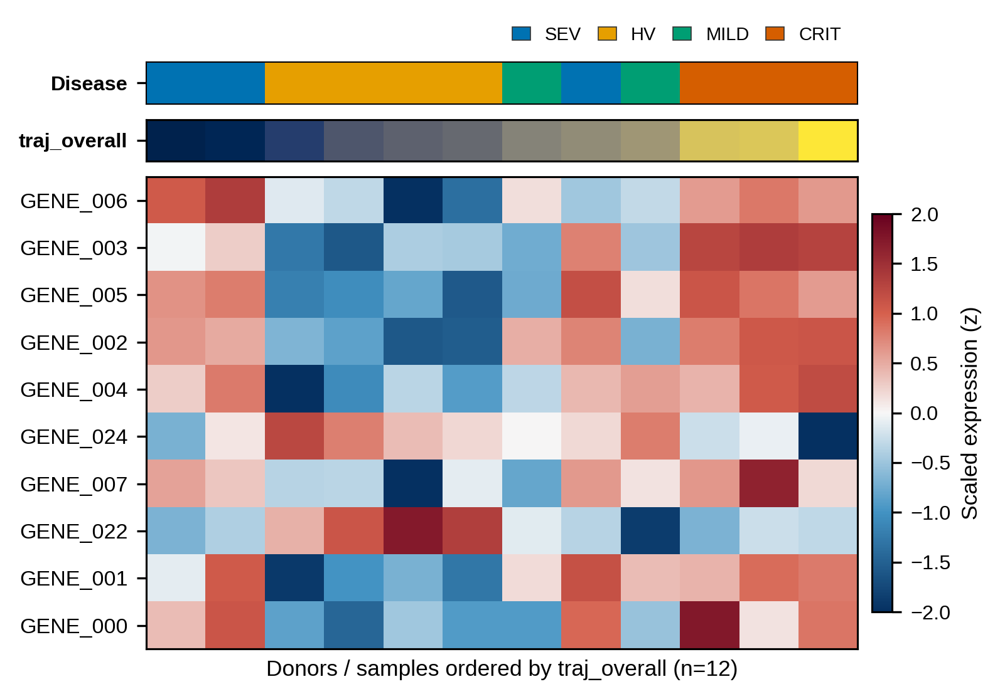
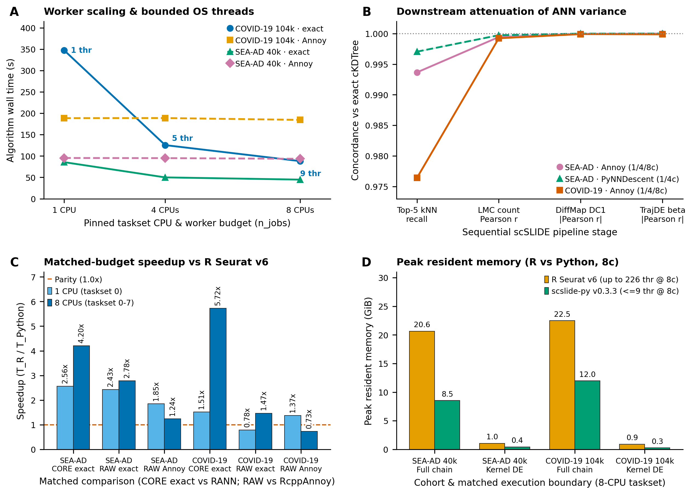

# scSLIDE-py

### 原版 scSLIDE 核心工作流的完整原生 Python 替代实现

**通过细胞状态的分布理解样本差异，而不只比较平均表达或细胞类型比例。** scSLIDE-py 将样本级单细胞分析带入 Python：覆盖原版 19 项核心能力，支持 AnnData、PLS 家族、WNN/landmark 密度、样本轨迹、描述性效应和带源数据的图形。**核心分析无需 R 或 rpy2。**

[English](README.md) · [文档](docs/README.md) · [R 对照](docs/comparison_with_R.md) · [图库](docs/gallery.md) · [性能](docs/benchmark.md)

**版本 0.3.3 · Linux x86_64 · Python 3.10–3.12 · MIT**

本项目是独立维护的社区实现，不是 Satija Lab 官方包。它为已说明的 R scSLIDE 工作流提供可靠的 Python 替代路径，不是整个 Seurat 生态或不经迁移的 R 脚本解释器。

## 为什么使用它？

| 优势 | 实际内容 |
|---|---|
| **完整核心流程** | grouped sketch、相关特征选择、PLSR/sPLS/CPPLS、投影、WNN、LMC、几何、校正、描述性 TrajDE、landmark 和绘图 |
| **Python 原生** | NumPy/SciPy/pandas 数值实现，独立安装，无隐藏 R 子进程 |
| **AnnData 互操作** | 明确区分 cell/sample/landmark；密集、CSR/CSC、已验证的 H5AD/Zarr 与分块路径 |
| **有 R 对照的实现** | 两套 R reference 的固定输出、真实数据匹配对照、负控和已知差异说明 |
| **可复用模型** | 按名称对齐特征、NPZ 保存读回、新 query 投影，避免基因列顺序错位 |
| **可解释的执行行为** | exact 默认、Annoy 可选；显式 UMAP 后端、worker 信息及可诊断错误 |
| **科研图与复现材料** | 样本图、landmark 图、热图、PNG/PDF/SVG、CSV 源数据及可移植示例 |

无需 OmicVerse 即可 `import scslide`。ov 接入是单独的可选入口，当前状态见 [集成说明](docs/omicverse_integration.md)。

## 从细胞到样本

```text
细胞表达 + 样本/受试者元数据 + 细胞状态 embedding
                         ↓
           grouped sketch 与表型相关 PLS 表示
                         ↓
            单模态或加权多模态 landmark 邻居
                         ↓
               landmark × sample 密度矩阵
                         ↓
           样本级 diffusion / trajectory / 描述性效应
                         ↓
                模型、结果表、图及 source-data
```

样本 AnnData 的 `obs` 是样本，`var` 是 landmark，不是通常的 cell×gene。重复采样也不能因列名叫 sample 就成为独立 subject。

## 实际输出预览

以下来自已经保存的 **合成入门示例**，不是伪造图片，也不是 COVID/SEA-AD 生物学发现。该用户任务使用 420 cells、60 genes、14 samples，并展示 12 个主要 subjects。

| 样本级结构 | Landmark 视图 |
|---|---|
|  |  |



[查看完整图库、矢量图与每张图的 CSV](docs/gallery.md)

## 安装

### 从公开地址安装（Python 3.11）

已验收 wheel 现在可以匿名下载，无需 GitHub 登录或克隆仓库。下面的地址固定软件提交和 SHA256；当前为 GitHub 分发，未上传 PyPI。

```bash
python3.11 -m venv .venv
source .venv/bin/activate
python -m pip install --constraint "https://raw.githubusercontent.com/LCGaoZzz/scSLIDE-py/57605d55054a3c26b0d30721f696ef67eab1809d/constraints/verified-primary-py311.txt" \
  "scslide-py[anndata] @ https://raw.githubusercontent.com/LCGaoZzz/scSLIDE-py/57605d55054a3c26b0d30721f696ef67eab1809d/artifacts/scslide_py-0.3.3-py3-none-any.whl#sha256=02043e3c1215320beca93c9ce58645f4fdebf29796dbbdc30d7ce00a580aacbd"
python -m pip check
```

[公开分发与下载验证记录](docs/PUBLICATION.md)

### 从仓库副本安装

在仓库根目录、独立 Python 3.11 环境中安装已验收的精确文件：

```bash
python3.11 -m venv .venv
source .venv/bin/activate
(cd artifacts && sha256sum -c SHA256SUMS)
python -m pip install --constraint constraints/verified-primary-py311.txt \
  "./artifacts/scslide_py-0.3.3-py3-none-any.whl[anndata]"
python -m pip check
```

推荐精确构建为 **`scslide-py-0.3.3-02043e3c1215`**，完整身份见 [manifest](artifacts/manifest.json)。历史内部候选曾共用 0.3.3 版本号，复现时不要只看版本字符串。

也可从当前源码安装 `python -m pip install ".[anndata]"`，但由当前源码重新构建的 ZIP 不等于原验收 ZIP。`[annoy]` 安装 Annoy，`[ann]` 对应 umap-learn/PyNNDescent；后者不包含 Annoy。公共 PyPI 安装入口未验证前不作已发布承诺。

## 快速运行

```python
import scslide as sl

adata = sl.build_synthetic_cohort_fixture(seed=20261116)
result = sl.run_scslide_workflow(
    adata,
    sample_col="Donor",
    subject_id_sep="-",  # 仅此合成示例的命名约定
    response_col="Disease",
    celltype_col="cell_type",
    embedding_key="X_pca",
    dims_embedding=range(8),
    ncells_per_group=20,
    ncells_landmark=40,
    knn_range=40,
    ncomp_pls=4,
    nn_method="exact",
    n_jobs=1,
    de_celltype="CD14_Mono",
    de_covariates=("Age", "Sex", "log_count"),
    de_inference_mode="descriptive_r_compat",
)
print(result.sample_adata)
print(result.diffusion.embeddings)
print(result.de_results["CD14_Mono"].head())
```

真实队列使用经过验证的 sample→subject 映射，不从名字随意猜。完整示例还包括 H5AD/Zarr、NPZ 模型保存重载、query 基因名称对齐和图形导出：

```bash
python examples/r_to_python_migration_quickstart.py --out-dir ./scslide-demo-output
```

[完整教程](docs/tutorial.md) · [R/Seurat 迁移](docs/R_TO_PY_MIGRATION.md)

## 为什么说它具备平替原版核心流程的能力？

不仅有相同任务的 API，还覆盖原版的参数和数值语义，并在保存的 R reference、公共数据案例与受影响路径上进行验证。

| 功能块 | Python 对应能力 |
|---|---|
| Sketch/相关选择/准备 | `sketch_data_by_group`、`quick_cor_select`、`prepare_sample_object` |
| PLS 家族与分块求解 | `fit_pls`、`run_pls`、`cppls_ondisk`、`kernelpls_ondisk` |
| 模型与 query | `PLSModel`、`predict_pls`、`project_pls_embeddings` |
| 邻域与样本密度 | `find_sm_nn`、`find_mm_nn`、`generate_sample_object`、`normalize_chi_squared` |
| 样本几何与效应 | `run_diffusion_map`、`fit_principal_curve`、`traj_de_test` |
| 控制样本校正 | `correct_sample_combat`、`cellanova_calc_be` |
| Landmark 与图形 | `build_landmark_object`、`run_and_project_umap`、`plot_landmark_object`、`sample_level_dim_plot` |

[完整 F01–F19 映射及分支说明](docs/algorithm.md)

### 真实病例的匹配输入对照

| 精确 R 对照读出 | COVID | SEA-AD Microglia-PVM |
|---|---:|---:|
| 病例输入细胞数 | 104,447 | 40,000 |
| 共同可检验基因 | 8,355 | 14,733 |
| LMC counts | 完全一致 | 完全一致 |
| 带符号轨迹排序相关性 | +1 | −1 |
| 带符号 TrajDE 系数相关性 | +0.99997068 | −0.99999922 |
| 过原点效应尺度比 | +0.9972623 | −0.99769023 |

**SEA-AD 的轨迹朝向反转，系数随之整体反号。** 这支持几乎相同的变化结构，而非原始正负号相同；解释疾病上调/下调前需明确轨迹生物学方向。exact 和 Annoy 对照分别记录。

已验收安装包有 **43 项独立包测试、47 条 stored-golden 检查和 6 项损坏负控**。真实病例表由已保存匹配输出复算，并不是本次文档整理重新运行病例；最后的资源元数据/错误处理修复也不冒充新增病例实验。

[详细 R 比较](docs/comparison_with_R.md) · [证据索引](docs/evidence_index.md)

## 速度与内存

历史 24 个配对条件中，20 个 Python 更快，4 个 R 更快；R/Python 算法时间比约 **0.70–5.72**，Python/R 峰值内存比约 **0.29–0.54**。



这些是有实际测量条件和版本的历史结果，包含 slower 条件，不是最终修复 ZIP 的普遍加速保证。完整记录见 [benchmark](docs/benchmark.md)。图中部分绝对相关性不能代替上文带符号方向说明。

## 适用问题与科学边界

scSLIDE 特别适合样本差异涉及细胞状态混合、连续异质性和分布形态的问题；纯组成变化可能用比例已经足够，均值变化任务中 pseudobulk 也可以很强。Python 版要保持原方法的科学能力与适用范围，不预设对所有任务普遍最优。

稳定核心支持文档中已验证的样本表示、存储、绘图和 R-compatible 描述性分析。监督标签参与表示学习，同一标签分离不是独立预测验证；学得轨迹后的 p/q 属描述性/选后结果。额外 OOF/count splitting/置换仍是探索性扩展，不作通用 FDR/FWER 保证。

## 文档与维护

[文档导航](docs/README.md) · [图库](docs/gallery.md) · [支持矩阵](docs/SUPPORTED_ENVIRONMENTS.md) · [科学用法](docs/scientific_usage_and_migration.md) · [维护与回滚](docs/MAINTENANCE_AND_ROLLBACK.md)

保留 [LICENSE](LICENSE)、[NOTICE](NOTICE) 与 [CITATION.cff](CITATION.cff) 的真实作者和方法来源。问题反馈提供脱敏最小复现，不上传患者矩阵或凭证。

**本仓库是独立算法主项目，OmicVerse 是可选适配入口。** 研发过程与公开软件材料分离，不影响算法源码、精确工件和必要验证材料的保存。

## OmicVerse 集成进展

可选适配器 [PR #1098](https://github.com/omicverse/omicverse/pull/1098) 与配套教程 [PR #145](https://github.com/omicverse/omicverse-tutorials/pull/145) 已有真实后端测试和全新内核 Notebook 执行记录，等待上游审核合并。公开安装已验证；上游合并、教程子模块和网站同步仍是后续独立步骤，详见[集成状态](docs/omicverse_integration.md)和[验证回执](docs/omicverse_validation.md)。
