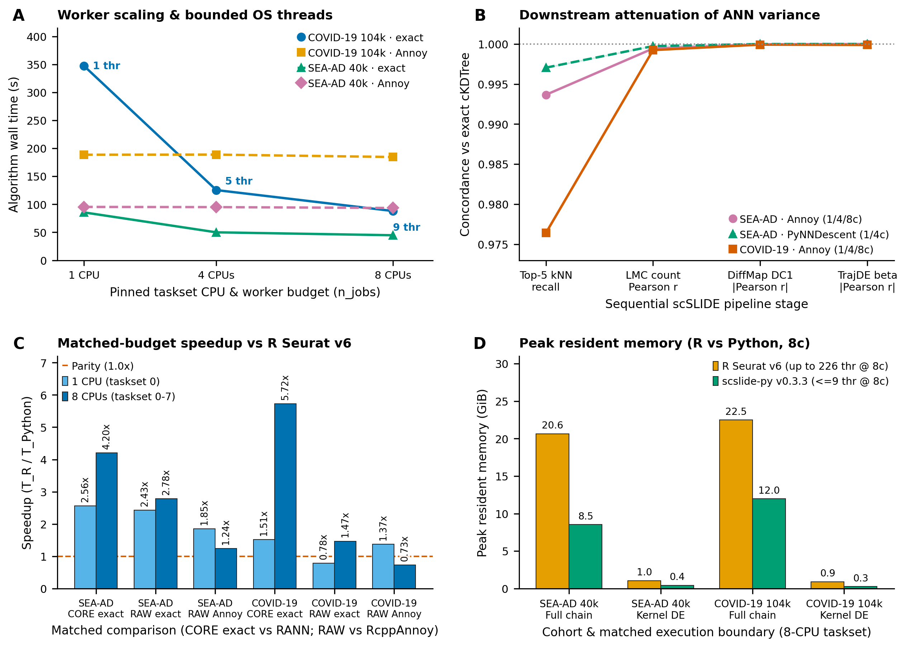

# Historical runtime and memory comparisons

[Home](../README.md) · [R comparison](comparison_with_R.md)

The retained figure and [CSV](assets/showcase/historical_release_acceptance.csv) contain historical measurements. They are **not a newly timed benchmark of the repaired 02043e artifact** or a universal speed guarantee.

There are 56 retained observations: 32 Python executions on an earlier 0.3.3 candidate and 24 R/Seurat-v6 executions, summarized into 24 paired conditions. Search profile, CPU budget and timing boundary matter. KERNEL and RAW_TO_RESULTS have two repeats per engine per budget; CORE_CHAIN has one. These records do not justify a high-precision performance interval.

Algorithm-time speedup is mean(T_R)/mean(T_Python). Twenty conditions favored Python (about 1.10–5.72×); the following four favored R:

| Dataset | Task | CPU budget | Speedup |
|---|---|---:|---:|
| COVID | differing defaults, RAW_TO_RESULTS | 1 | 0.7823 |
| COVID | differing defaults, CORE_CHAIN | 1 | 0.7298 |
| COVID | same Annoy, RAW_TO_RESULTS | 8 | 0.7262 |
| COVID | same Annoy, CORE_CHAIN | 8 | 0.7010 |

Python/R peak-RSS ratios were approximately 0.29–0.54. RAW_TO_RESULTS includes raw-count normalization/HVG through results but its algorithm timer excludes I/O. Process wall time also includes startup/loading; original R binary and Python H5AD formats differ. Missing historical quota snapshots, I/O bytes and temporary timing files remain unknown, not reconstructed facts.

[SVG](assets/showcase/historical_release_acceptance.svg) · [CSV source data](assets/showcase/historical_release_acceptance.csv)

Some plot panels show absolute correlations. Read the signed SEA-AD orientation in [R comparison](comparison_with_R.md); absolute r is not raw effect-direction equality.

Exact tree construction is serial, queries can be parallel. Annoy receives construction workers and queries serially. BLAS/OpenMP/numba are separate thread pools. Report active CPU constraints as well as requested workers. A failed or slower condition is retained rather than removed to improve the headline.
