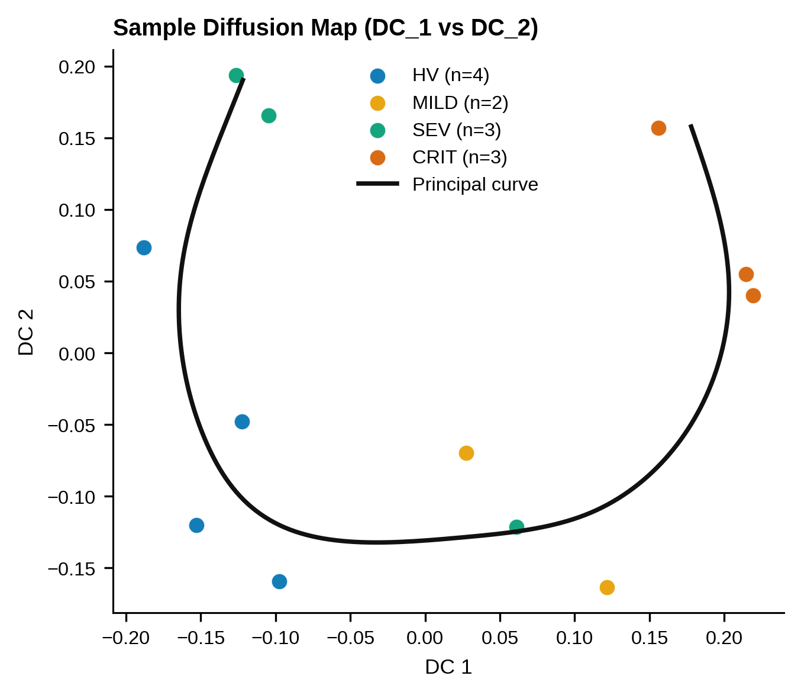
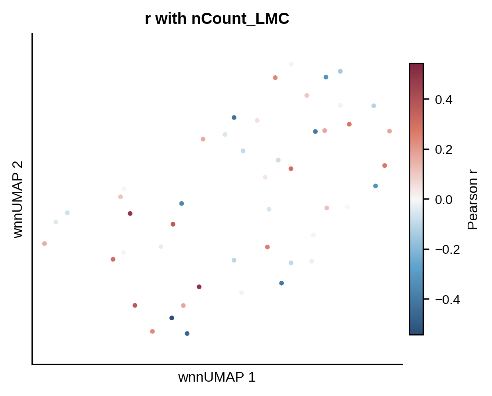
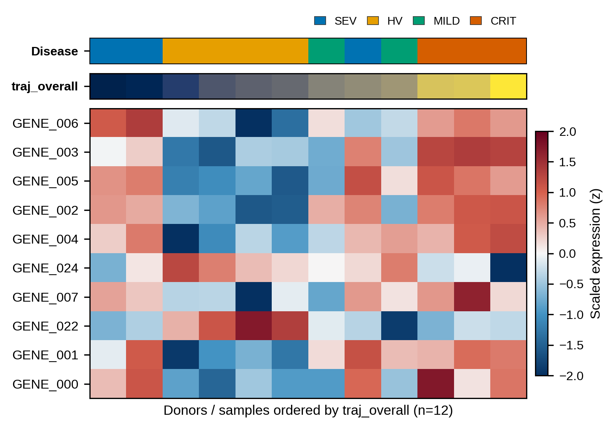

# Gallery

[Home](../README.md) · [Tutorial](tutorial.md) · [R comparison](comparison_with_R.md)

These are byte-identical copies of existing outputs. No scatter points or biological effects were generated from summary statistics to create this page.

## Portable synthetic example

The installed-package example has 420 cells and 60 genes, 14 samples and a 12-primary-subject displayed task. Its group labels are synthetic, not real diagnoses. Run [the example](../examples/r_to_python_migration_quickstart.py) without private cohort data.

### Sample-level geometry

[CSV](assets/showcase/sample_diffusion.csv) · [SVG](assets/showcase/sample_diffusion.svg) · [PDF](assets/showcase/sample_diffusion.pdf)

### Landmark-state visualization

[CSV](assets/showcase/landmark_umap.csv) · [SVG](assets/showcase/landmark_umap.svg) · [PDF](assets/showcase/landmark_umap.pdf)

Landmark coordinates are not independent subjects. The displayed correlation is a sample-level quantity; it is not a causal interaction.

### Expression along a sample trajectory

[CSV](assets/showcase/trajectory_heatmap.csv) · [SVG](assets/showcase/trajectory_heatmap.svg) · [PDF](assets/showcase/trajectory_heatmap.pdf)

Ten synthetic genes are displayed across ordered primary subjects with standardized expression. This is an interface demonstration, not a list of confirmed disease genes. Legends are panel-specific.

## Real-case validation and resources

The aggregate COVID/SEA-AD [comparison table](../validation/results/r_case_summary.tsv) is separate from the synthetic images. The [historical resource figure](benchmark.md) uses archived measurements and explicitly retains its older measured builds. It is not a fresh timing experiment.

The [asset provenance](assets/showcase/README.md) and [validation guide](../validation/README.md) explain the distinction between stored-reference verification, saved case-result reanalysis and fresh execution.
